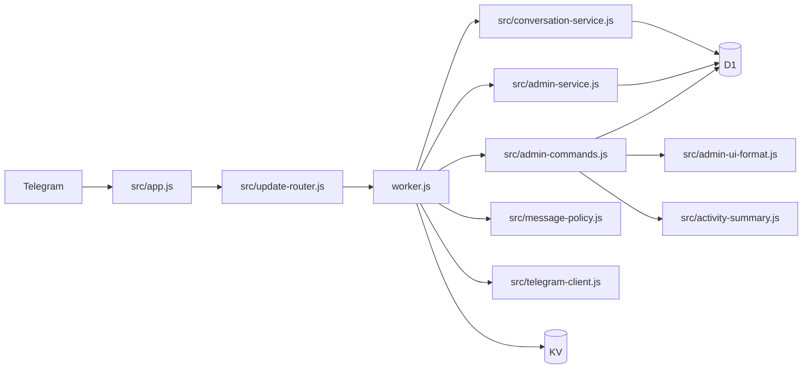

# Telegram Private Chat Gateway - 维护者文档

> Cloudflare Workers 上的 Telegram 私聊安全接入与双向会话网关。

## 项目定位

项目将 Telegram Bot 私聊转换为管理员超级群组中的独立 Forum Topic，并在消息进入会话前执行 Webhook 校验、幂等声明、人机验证和内容策略。管理员在 Topic 中统一回复用户，并通过角色权限管理用户状态和规则。

## 技术栈

| 层级 | 技术 |
|------|------|
| 运行时 | Cloudflare Workers ES Modules |
| 长期状态 | Cloudflare D1 |
| 短期状态 | Cloudflare KV |
| 消息平台 | Telegram Bot API 和 Forum Topics |
| 人机验证 | Cloudflare Turnstile / 本地题库 |
| 测试 | Vitest、Mock KV、Mock D1、Mock Telegram |
| 文档 | Markdown、Mermaid、自动索引脚本 |

## 架构入口



## 模块索引

| 路径 | 职责 |
|------|------|
| `worker.js` | Telegram 业务编排、验证、会话转发、用户状态命令、媒体组；接入管理看板 handlers |
| `src/app.js` | HTTP 安全入口、Webhook 校验、migrations 和 Scheduled 入口 |
| `src/update-router.js` | Telegram Update 幂等声明、完成和重试状态 |
| `src/conversation-service.js` | 编辑消息映射与修改通知（新消息/话题链路由 worker.js 编排） |
| `src/admin-service.js` | 角色权限、资料卡操作（`v1:*`）、规则和审计 |
| `src/admin-commands.js` | 群管理命令与 `adm:*` 回调编排（menu/sysinfo/stats/rank/find/notes） |
| `src/admin-actions.js` | 管理动作命令：用户状态操作、词库管理、批量清理 |
| `src/verification.js` | 人机验证编排：本地题库 + Turnstile + 待发消息回放 |
| `src/media-group.js` | 媒体组合并延迟转发与过期清理 |
| `src/blocked-words.js` | 屏蔽词库（硬编码 + KV 动态）共享读取 |
| `src/daily-stats.js` | CST 日历日统计 KV 读写共享 |
| `src/admin-ui-format.js` | 管理键盘与展示纯函数 |
| `src/activity-summary.js` | CST 日切、热力、sparkline、峰值日 |
| `src/verify-copy.js` | 人机验证用户侧文案 |
| `src/verify-page.js` | Turnstile 验证页 HTML 模板与渲染（暗色模式/加载态，可单测） |
| `src/user-copy.js` | 用户拦截/限流与管理告警文案 |
| `src/message-policy.js` | 内容分类、规则校验和策略评估 |
| `src/telegram-client.js` | Telegram API 超时、重试和错误分类 |
| `src/logger.js` | 结构化日志和递归脱敏 |
| `src/maintenance-service.js` | D1 保留期清理 |
| `src/storage/` | D1、KV、短期状态和 Schema migrations |
| `tests/unit/` | 纯函数和服务单元测试 |
| `tests/integration/` | HTTP、D1、会话、幂等、管理命令和维护集成测试 |

## 开发命令

```bash
pnpm install
pnpm run dev
pnpm run test:unit
pnpm run test:integration
pnpm test
pnpm run test:coverage
pnpm run build:single
pnpm run sync-docs
```

生产发布：粘贴 `dist/worker.single.js` 到 Cloudflare Dashboard，Bindings/变量/Cron 在控制台配置（见 `docs/deployment.md`）。  
提交时若变更了业务源码（`worker.js` / `src/` / `package.json` / `pnpm-lock.yaml`），pre-commit 会自动递增版本号（patch 逢 10 进位到 minor，minor 逢 10 进位到 major，同步 `worker.js` / `package.json`）并重建 dist（`pnpm install` 后 hooks 生效）。

项目没有独立 lint 或 TypeScript typecheck。提交前还应对全部 JavaScript 文件运行 `node --check`，并运行 `git diff --check`。

## 配置边界

- Secrets：`BOT_TOKEN`、`WEBHOOK_SECRET`、可选 `TURNSTILE_SECRET_KEY`
- 必需变量：`SUPERGROUP_ID`
- 推荐变量：`OWNER_IDS`
- 必需 Bindings：`TOPIC_MAP`、`TG_BOT_DB`
- 可选变量：`TURNSTILE_SITE_KEY`、`VERIFICATION_PAGE_URL`、`ADMIN_IDS`、`SPAM_KEYWORDS`、`API_BASE`

完整说明见 `docs/configuration.md`。

## 编码约束

- 保持 `src/app.js` 与 Telegram 业务逻辑解耦。
- 会话和管理员服务通过注入的 storage、telegram 和 logger 接口访问外部状态。
- 群管理 UI（`adm:*`）走 `admin-commands` + `admin-ui-format`；资料卡 `v1:*` 走 `admin-service`，勿混权限模型。
- 用户可见文案：验证用 `verify-copy.js`，其余拦截/限流用 `user-copy.js`。
- 日统计 KV `stats:YYYY-MM-DD` 使用 **CST（UTC+8）** 日历日。
- 用户状态使用 D1 原子部分更新，避免读取整行后覆盖并发状态。
- D1 数据值使用 `.bind()`；动态列名必须来自内部白名单。
- Callback、规则类型、动作和 API Base URL 使用白名单。
- 日志不得包含完整 Telegram Update、消息正文或真实凭据。
- 不要将 `docs/superpowers/` 提交进 Git。
- 新行为和 Bug 修复先写失败测试，再实现最小修复。
- 功能、配置、部署或安全行为变化时同步 README、专题文档和 Changelog。

## 文档导航

- `README.md` / `README_EN.md`：产品首页
- `docs/deployment.md`：从零部署
- `docs/configuration.md`：配置参考
- `docs/architecture.md`：模块与数据流
- `docs/operations.md`：运维和发布检查
- `docs/development.md`：开发和验证流程
- `docs/security.md`：安全边界
- `CHANGELOG.md`：版本历史

## 自动生成索引

以下区块由 `scripts/sync-claude-md.js` 维护。修改 `worker.js`、`src/utils.js` 或 CONFIG 后运行：

```bash
pnpm run sync-docs
```

<!-- AUTO-GENERATED START: functions -->

## 关键函数索引（自动生成）

> 由 `scripts/sync-claude-md.js` 自动生成，最后同步：2026-08-27。

### worker.js 主函数

| 函数 | 行号 | 职责 |
|------|------|------|
| `setBoundedCache` | L121 | — |
| `recordSystemError` | L144 | — |
| `ephemeralStore` | L255 | — |
| `getVerificationState` | L259 | — |
| `getStoredRules` | L275 | — |
| `evaluateLegacyPolicy` | L285 | — |
| `createLegacyConversationService` | L304 | — |
| `parseIdAllowlistSet` | L317 | — |
| `parseIdAllowlist` | L336 | — |
| `idAllowlistHas` | L340 | — |
| `createLegacyAdminService` | L344 | — |
| `setPersistentTrust` | L354 | — |
| `readLegacyKvUser` | L368 | 替代已删除的 createKVStorage 模块，仅保留 setPersistentTrust 需要的字段。 |
| `saveLegacyMessageLink` | L380 | — |
| `secureRandomInt` | L399 | 加密安全的随机数生成（拒绝采样消除取模偏差） |
| `safeGetJSON` | L413 | 安全的 JSON 获取 |
| `verifyJsonResponse` | L431 | 验证相关 JSON 响应统一禁用缓存：验证 code 单次有效，任何缓存都会导致过期误判 |
| `isSparseTelegramFrom` | L444 | 判断 Telegram from 是否缺少可用于话题标题的资料字段。 |
| `profileFingerprint` | L460 | 用户资料极少变动，高频消息流可把「每消息一次 KV put」降为「资料变化时才写」。 |
| `saveUserProfileSnapshot` | L464 | — |
| `resolveUserFromForTopic` | L489 | 修复 Turnstile 验证通过后 fakeMsg 仅含 id 导致标题变成「User」的问题。 |
| `getOrCreateUserTopicRec` | L553 | — |
| `probeForumThread` | L640 | — |
| `resetUserVerificationAndRequireReverify` | L696 | — |
| `parseAdminIdAllowlist` | L722 | — |
| `isAdminUser` | L727 | — |
| `getAllKeys` | L766 | 获取所有 KV keys（处理分页；maxPages=0 表示不限制页数） |
| `shuffleArray` | L782 | Fisher-Yates 洗牌算法 |
| `checkRateLimit` | L792 | 速率限制检查 |
| `sendHourlyNotice` | L1122 | 低频状态（封禁/静音）每小时最多提醒一次：避免用户反复发送时被重复打扰。 |
| `handlePrivateMessage` | L1134 | — |
| `forwardToTopic` | L1246 | 职责：前置检查 → 获取/创建话题 → 健康检查 → 执行转发 |
| `checkThreadHealth` | L1353 | 话题健康检查 — 双层缓存（内存 + KV）+ 探测 |
| `executeMessageForward` | L1416 | 执行消息转发 — forwardMessage → copyMessage 降级 + 重定向检测 |
| `handleForwardRedirect` | L1460 | 处理转发重定向 — 删除误投消息 + 触发重建 |
| `notifyAdmin` | L1492 | 同类型告警按 ALERT_THROTTLE_MS 节流；发送失败仅记录日志，不得影响主流程。 |
| `handleForwardFailure` | L1511 | 处理转发失败 — 话题丢失检测 + copyMessage 降级 + 通知管理员 |
| `removeCommandBotSuffix` | L1569 | 例如：/listwords@callcosr_bot -> /listwords |
| `handleAdminReply` | L1575 | — |
| `isOwnerUser` | L1589 | --- 管理员命令处理函数 --- |
| `resolveThreadIdForUser` | L1597 | — |
| `_handleAdminReplyInner` | L1614 | 职责：权限检查 → 全局命令路由 → 用户反查 → 话题内指令路由 → 消息转发 |
| `createTopic` | L1819 | 为话题建立 thread->user 映射，避免管理员命令时全量 KV 反查 |
| `updateThreadStatus` | L1833 | 更新话题状态 |
| `buildTopicTitle` | L1878 | 资料缺失时勿在调用方传入仅 { id } 的 from（会退化为 "User"）；应先 resolveUserFromForTopic。 |
| `getTelegramClient` | L1907 | — |
| `tgCall` | L1925 | 改进的 Telegram API 调用（添加超时和 HTTPS 强制） |

### src/utils.js 纯函数

| 函数 | 行号 | 职责 |
|------|------|------|
| `cleanProfileText` | L12 | 供话题标题与资料卡展示共用，保证各处清理规则一致。 |
| `escapeHtml` | L25 | 定义在纯函数基座模块，避免页面模块反向依赖管理 UI 模块。 |
| `containsBlockedWord` | L41 | 检查文本是否包含屏蔽词 |
| `extractMessageText` | L55 | 提取消息正文与媒体说明，供新消息和编辑消息共享策略。 |
| `containsLink` | L68 | 检测消息文本中是否包含 URL/链接 |
| `buildSpamCheckText` | L84 | 构建反垃圾检测文本：消息正文 + 发送者资料 |
| `detectSpamKeywords` | L104 | 检测消息是否包含垃圾关键词 |
| `computeMessageHash` | L122 | 计算消息内容的简单哈希（用于重复检测） |
| `normalizeTgDescription` | L136 | 标准化 Telegram API 描述字符串 |
| `isTopicMissingOrDeleted` | L145 | 判断话题是否不存在或已被删除 |
| `isTestMessageInvalid` | L161 | 判断探测消息是否因内容为空而失败 |
| `truncateText` | L177 | 编辑通知（user-copy）与按钮标签（admin-ui-format）共用，避免两处截断规则漂移。 |
| `formatUserName` | L189 | 管理面板/资料卡/看板共用，避免各处重复拼接导致规则漂移。 |
| `commandArgument` | L207 | 替代各处手写 slice(9) / 正则，统一支持 @bot 后缀，避免命令前缀长度漂移。 |
| `isAdminCommandText` | L231 | worker.js 私聊拦截与群内权限提示共用同一命令清单，避免两处维护漂移。 |
| `isPlaceholderTopicTitle` | L242 | 语义 = 旧 worker 规则（=== 'User' 或 /^User @/i）与旧 admin-actions 规则（=== 'User' 或 /^User(\s@|$)/i）的并集。 |
| `withMessageThreadId` | L254 | 为请求 body 添加 message_thread_id 字段 |
| `parseSpamKeywords` | L264 | 将 SPAM_KEYWORDS 环境变量解析为关键词数组 |
| `generateVerifyCode` | L276 | 生成安全的验证 code（16 字节十六进制） |
| `secureRandomId` | L289 | 字节值超出 [0, limit) 均匀区间时丢弃重采，保证每个字符等概率出现。 |
| `createThrottle` | L308 | 用于管理告警等高频路径，防止故障期间告警风暴刷屏。 |
| `normalizeRecentErrorItem` | L336 | 避免两处各自实现同一套截断规则导致展示漂移。 |

<!-- AUTO-GENERATED END: functions -->

<!-- AUTO-GENERATED START: config -->


## CONFIG 配置项（自动生成）

> 由 `scripts/sync-claude-md.js` 自动生成，对应 worker.js 中的 CONFIG 对象。

| 配置项 |
|--------|
| `VERIFY_ID_LENGTH` |
| `VERIFY_EXPIRE_SECONDS` |
| `VERIFIED_EXPIRE_SECONDS` |
| `MEDIA_GROUP_EXPIRE_SECONDS` |
| `MEDIA_GROUP_DELAY_MS` |
| `PENDING_MAX_MESSAGES` |
| `ADMIN_CACHE_TTL_SECONDS` |
| `NEEDS_REVERIFY_TTL_SECONDS` |
| `RATE_LIMIT_MESSAGE` |
| `RATE_LIMIT_VERIFY` |
| `RATE_LIMIT_WINDOW` |
| `BUTTON_COLUMNS` |
| `MAX_TITLE_LENGTH` |
| `MAX_NAME_LENGTH` |
| `API_TIMEOUT_MS` |
| `CLEANUP_BATCH_SIZE` |
| `MAX_CLEANUP_DISPLAY` |
| `CLEANUP_LOCK_TTL_SECONDS` |
| `MAX_RETRY_ATTEMPTS` |
| `THREAD_HEALTH_TTL_MS` |
| `TURNSTILE_VERIFY_TTL` |
| `NEW_USER_LINK_BLOCK_SECONDS` |
| `SPAM_MESSAGE_HASH_TTL` |
| `SPAM_REPEAT_MESSAGE_LIMIT` |
| `SPAM_NOTIFY_ADMIN` |
| `SPAM_SILENCE_MODE` |
| `ALERT_THROTTLE_MS` |
| `WORD_MAX_LENGTH` |
| `MEDIA_GROUP_CLEANUP_PROBABILITY` |
| `RETRY_COUNT_TTL_SECONDS` |

<!-- AUTO-GENERATED END: config -->

<!-- AUTO-GENERATED START: kv-keys -->


## KV 键名约定（自动生成）

> 由 `scripts/sync-claude-md.js` 自动扫描 `env.TOPIC_MAP` 调用提取。

| 键名模式 |
|----------|
| `banned:{id}` |
| `muted:{id}` |
| `needs_verify:{id}` |
| `profile:{id}` |
| `retry:{id}` |
| `sys:recent_errors` |
| `thread:{id}` |
| `turnstile_code:{id}` |
| `turnstile_msg:{id}` |
| `user_challenge:{id}` |

<!-- AUTO-GENERATED END: kv-keys -->
